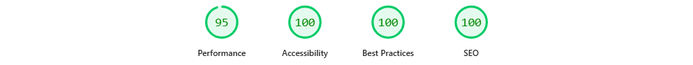

# BLOCK/HEIGHT 2027

En one-pager för en påhittad utvecklarkonferens om blockkedjeinfrastruktur: två dagar i Stockholm,
10–11 juni 2027. Sidan är byggd med HTML och Sass och har ingen JavaScript.

**Live:** <https://samlekkla.github.io/inl2-konferens/>

## Projektbeskrivning

Sidan ska se ut som en terminal eller en block explorer, utan de vanliga kryptoklichéerna. Den har
ett mörkt tema ("mainnet") och ett ljust ("testnet"). Sidan väljer tema efter
`prefers-color-scheme`.

- **Hero** med blinkande terminalmarkör, nyckeltal i en `<dl>` och en rad blockhashar som rullar
  förbi.
- **Program** som en kedja av block. Blocken numreras med en CSS-räknare och tiderna är märkta med
  `<time datetime>`.
- **Talare** som noder med en pulserande statusprick. Vid hover eller fokus går bilden från gråskala
  till färg och detaljer visas.
- **Biljetter** som transaktionskvitton (Light Node, Full Node, Validator, Sponsor Block), alla med
  "GAS FEE: 0".
- **Praktisk info** med `<address>`, vägbeskrivning med tunnelbana och en egen statisk SVG-karta.

Alla animationer rör bara `transform` och `opacity` och ligger inuti
`@media (prefers-reduced-motion: no-preference)`. De stängs alltså av helt för den som valt minskad
rörelse.

## Kom igång

Kräver Node.js 18 eller senare.

```bash
npm install          # installerar sass, prettier, html-validate och Playwright
npm run dev          # bevakar scss/ och kompilerar till css/style.css vid varje ändring
npm run build        # kompilerar en gång (görs före varje commit)
npm run format       # Prettier på hela projektet
npm run validate     # html-validate på index.html
npm test             # Playwright: kontrollerar att sidan inte scrollar i sidled
```

Första gången `npm test` körs behöver webbläsaren installeras: `npx playwright install chromium`.

### Filstruktur

```text
index.html
scss/
  style.scss            # bara @use av alla partials
  _variables.scss       # typsnitt, storlekar, avstånd, brytpunkter, temafärger
  _mixins.scss          # space(), fs(), mq(), motion, gutter
  _tokens.scss          # CSS-variabler för båda teman
  _base.scss            # nollställning och elementstilar
  _layout.scss          # sidhuvud, nav, sektioner, sidfot, skip-link
  components/           # en fil per BEM-block
css/style.css           # kompilerad
img/                    # egna SVG:er (alla under 3 kB)
tests/overflow.spec.js  # Playwright-test
```

## BEM

Alla klasser följer **Block\_\_Element--Modifier**. Varje block har en egen partial i
`scss/components/`. Ett element hör alltid till ett block och nästlas aldrig vidare
(`node__name`, aldrig `node__header__name`).

| Typ      | Exempel                                 | Betydelse                                    |
| -------- | --------------------------------------- | -------------------------------------------- |
| Block    | `.node`                                 | Ett talarkort, kan stå för sig självt        |
| Element  | `.node__avatar`, `.node__role`          | Delar som bara finns inuti ett `.node`       |
| Block    | `.ticket`                               | Ett biljettkvitto                            |
| Element  | `.ticket__ledger`, `.ticket__cta`       | Kvittoraderna och köpknappen                 |
| Modifier | `.ticket--featured`                     | Variant: den utvalda biljetten med grön kant |
| Modifier | `.button--primary`                      | Variant: fylld knapp i stället för kontur    |
| Block    | `.chain` / `.block`                     | Programmets kedja och varje block i den      |
| Element  | `.site-nav__link`, `.site-footer__link` | Layoutblock använder samma namngivning       |

```html
<article class="ticket ticket--featured" data-tx="0x7f3a…c218">
  <h3 class="ticket__title">Full Node</h3>
  <dl class="ticket__ledger">…</dl>
  <a class="button button--primary ticket__cta" href="…">Köp</a>
</article>
```

Ett element kan också vara ett block, som `a.button.ticket__cta` ovan. Knappens utseende kommer från
`.button` och placeringen i kvittot från `.ticket__cta`.

## Avancerade selektorer

| Selektor                                      | Fil                         | Varför                                                                                                 |
| --------------------------------------------- | --------------------------- | ------------------------------------------------------------------------------------------------------ |
| `ul[class], ol[class]`                        | `_base.scss`                | Attributselektor: bara listor med klass nollställs, vanliga listor i löptext behåller sina punkter.    |
| `.site-nav__link[href^="#"]::before`          | `_layout.scss`              | Attribut som _börjar med_: länkar till ankare på sidan får ett `#` framför sig.                        |
| `.section[data-block]::before`                | `_layout.scss`              | Hämtar sektionens hash ur `data-block` med `attr()`. Dekoren ligger i CSS och inte i texten.           |
| `.ticket[data-tx]::before`                    | `components/_tickets.scss`  | Samma teknik för kvittots transaktions-id.                                                             |
| `.ticket__value:nth-of-type(2)`               | `components/_tickets.scss`  | Strukturell pseudoklass: det andra värdet (gas fee) blir grönt utan en extra klass.                    |
| `.chain__item:not(:last-child)::after`        | `components/_schedule.scss` | Linjen mellan blocken ritas för alla utom det sista, så kedjan slutar snyggt.                          |
| `.schedule__day + .schedule__day`             | `components/_schedule.scss` | Syskonkombinator: avstånd bara _mellan_ dagarna, inte före den första.                                 |
| `.hero > :not(.hero__image)`                  | `components/_hero.scss`     | Barnkombinator med `:not()`: allt utom bilden placeras i första kolumnen på desktop.                   |
| `.hero__stat:last-child .hero__stat-value`    | `components/_hero.scss`     | Sista nyckeltalet ("Gas fee 0") får accentfärg.                                                        |
| `.info__term:not(:first-child)`               | `components/_info.scss`     | Avstånd ovanför varje rubrik i listan utom den första.                                                 |
| `.node:target`                                | `components/_speakers.scss` | Talarkortet lyser upp när man klickat på talarens namn i programmet.                                   |
| `.node:has(.node__link:focus-visible)`        | `components/_speakers.scss` | Föräldraselektor: hela kortet markeras när länken inuti har tangentbordsfokus.                         |
| `.node:hover .node__details`, `:focus-within` | `components/_speakers.scss` | Visar detaljerna både med mus och tangentbord, och bara i `@media (hover: hover) and (pointer: fine)`. |
| `:focus-visible`                              | `_base.scss`                | Egen fokusring som syns vid tangentbordsnavigering men inte vid musklick.                              |

## Kontrast (WCAG 2.2 AA)

Kontrasten är uträknad med WCAG:s formel för relativ luminans. Kravet är 4,5:1 för brödtext och 3:1
för stor text och grafiska delar som fokusringen. Varje färg är testad mot alla tre bakgrundsnivåer.
Tabellen visar det sämsta värdet.

| Färgpar                           | Mainnet (mörkt)               | Testnet (ljust)               | Krav | OK  |
| --------------------------------- | ----------------------------- | ----------------------------- | ---- | --- |
| Text / bakgrund                   | `#e6ebe8` / `#0d0f0e` = 15,95 | `#111513` / `#eceeec` = 15,79 | 4,5  | ✔   |
| Text / kort (sämsta)              | 13,38                         | 17,14                         | 4,5  | ✔   |
| Dämpad text / bakgrund            | `#9aa59f` = 7,56              | `#4a534e` = 6,82              | 4,5  | ✔   |
| Dämpad text / kort (sämsta)       | 6,34                          | 7,41                          | 4,5  | ✔   |
| Accent (länkar) / bakgrund        | `#3dff9a` = 14,63             | `#08703f` = 5,30              | 4,5  | ✔   |
| Accent / kort (sämsta)            | 12,27                         | 5,75                          | 4,5  | ✔   |
| Varning (tider, fokus) / bakgrund | `#ffb547` = 10,95             | `#8a5000` = 5,58              | 4,5  | ✔   |
| Varning / kort (sämsta)           | 9,18                          | 6,06                          | 4,5  | ✔   |
| Text på accentknapp               | `#04130b` / `#3dff9a` = 14,48 | `#ffffff` / `#08703f` = 6,18  | 4,5  | ✔   |
| Fokusring / bakgrund (icke-text)  | 10,95                         | 5,58                          | 3    | ✔   |

Kantlinjerna (`--color-line`) är bara dekor. Korten känns igen på sitt innehåll, så de omfattas inte
av kravet för grafiska objekt.

## Testning och validering

- **html-validate:** `npm run validate` ger 0 fel (`html-validate:recommended` och `prettier`).
  Livesidan kan även kontrolleras i [W3C:s validator](https://validator.w3.org/nu/?doc=https%3A%2F%2Fsamlekkla.github.io%2Finl2-konferens%2F).
- **Horisontell scroll:** `npm test` kontrollerar att `scrollWidth <= clientWidth` vid 320, 768,
  1024 och 1440 px samt vid 200 % och 300 % zoom på 1440 px (720 och 480 px viewport), i båda
  teman. Det blir 12 tester. Skärmdumparna sparas i `tests/screenshots/`.
- **Lighthouse (mobil):** Performance 95 · Accessibility 100 · Best Practices 100 · SEO 100.
  Kört med `npx serve` och `npx lighthouse http://localhost:3000 --form-factor=mobile`.



## AI-logg och reflektion

### Logg

Jag har använt Claude Code (i terminalen i VS Code) som stöd genom hela projektet. Jag gav
kravspecen och bad om att arbetet skulle delas upp i faser. Efter varje fas granskade jag resultatet
innan vi gick vidare.

- **Fas 1:** projektet sattes upp med npm, Sass, Prettier och html-validate, och all HTML skrevs.
- **Fas 2:** SVG-bilderna och all styling i Sass. Sidan testades i fyra bredder och kolumnerna
  justerades så att inget bröts vid 1024 px.
- **Fas 3a:** egen fokusmarkering, skip-link och ett Playwright-test mot horisontell scroll.
- **Fas 3b:** Lighthouse, kontrastberäkning och README.

Jag skapade repot, slog på GitHub Pages och gjorde alla push själv. Jag valde också bort
AI-signaturen i commit-meddelandena, bytte namn på en av talarna och delade upp sista fasen på två
dagar.

### Reflektion

Det jag tar med mig är att man kan låta AI bearbeta det man själv tänker. Jag bestämmer vad som ska
göras och hur det ska se ut, och AI:n hjälper till att formulera det i kod. Den är mest användbar
till sådant man annars gör om och om igen: att sätta upp verktyg, skriva liknande komponenter, testa
samma sak i flera skärmbredder och räkna kontrast för varje färgpar. Då kan jag lägga min tid på att
förstå lösningarna och kontrollera att resultatet blev som jag ville.

Samtidigt går det inte att lita blint på det som kommer ut. Jag behövde granska varje fas och be om
ändringar när något inte stämde. För att kunna förklara koden själv har jag gått igenom varför
varje val gjordes, till exempel BEM, `:has()` och varför animationerna ligger i
`prefers-reduced-motion`. Nästa gång skulle jag använda AI på samma sätt, men skriva fler delar själv
först och låta AI:n granska dem, så att jag lär mig ännu mer på vägen.
